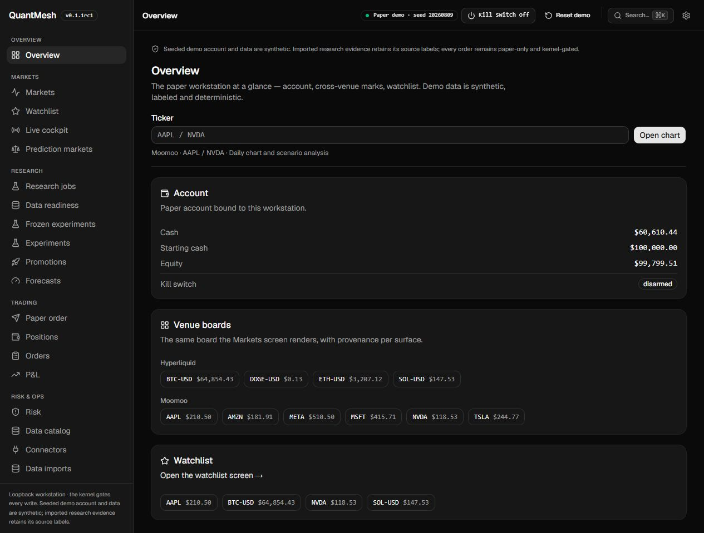
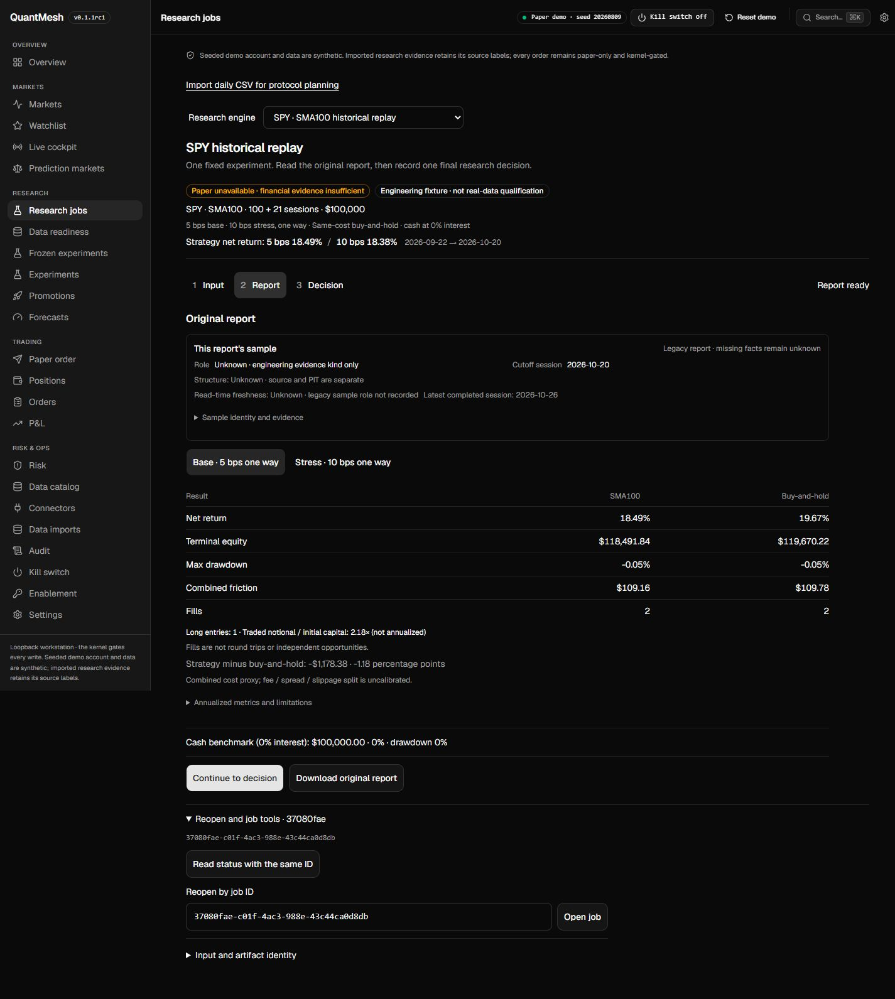
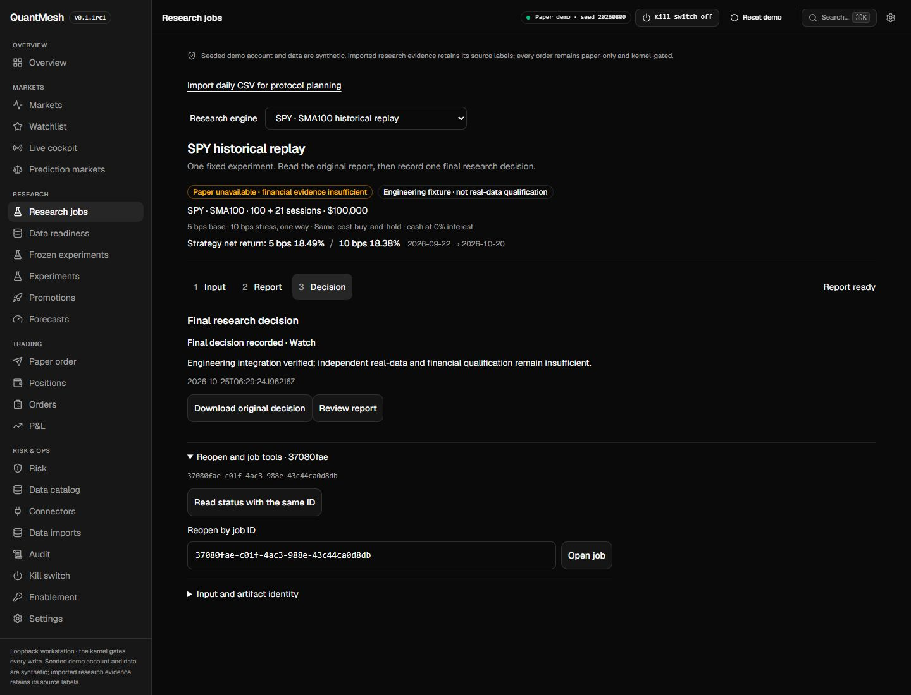

<div align="center">

# QuantMesh

**一个以本地运行和可复现研究为核心、用确定性规则守护模拟交易决策的工作台。**

[快速开始](#快速开始) · [主要能力](#主要能力) ·
[运行模式](#运行模式) · [文档](#架构与文档) ·
[English](README.md)

[](https://github.com/ZP151/quantmesh/actions/workflows/ci.yml)
[](LICENSE)

</div>

QuantMesh 把市场观测、数据质量、实验依据、报告和操作者决定连接成可重开的
工作流。重新打开结果时，原始输入及其身份仍可核查；证据缺口会明确显示，
不会被当作策略成功或交易授权。

## 主要能力

- **检查本地数据。** 导入受支持的日线 CSV 或快照包，查看来源、交易日覆盖、
  时间戳和定位到具体位置的质量问题，并下载保留的原件。结构检查通过不等于
  数据权利、历史时点有效性或研究资格已获证实。
- **阅读冻结的研究依据。** 查看受支持的冻结实验及其输入、协议、成本假设、
  基准、风险说明和原始工件。导入历史结果只供核查；界面不会暗中重跑或晋级。
- **运行并找回有界研究任务。** 经显式配置的回放工作流可持久保存任务、
  取消运行、在重启后重开原报告，并将最终 Reject 或 Watch 决定绑定到原报告。
  vn.py 固定样例实验是另一个可选外部运行时，有独立的依赖和许可边界；
  正在运行的 vn.py 任务不会在重启后继续。
- **查看行情与决策。** 浏览带来源标记的图表、情景、DecisionPacket 和结果
  复盘。显式启用的只读行情模式展示真实来源、时间和覆盖范围；BTC 纯行情
  模式保留有界分钟缓存。实时报价本身不能使研究数据集取得资格。
- **用确定性规则演练 Paper。** 提案经过人工确认、报价与风险检查、限额、
  日志及暂停开关。Paper 是默认模式；真实资金执行需要另行授权和验收。
- **按需使用 Advisory 解释。** 配置后，带引用的 AI 输出可辅助阅读研究依据，
  但无权下单；本地演示不依赖它。看到解释不等于策略有效或真实模型调用已验收。

## 快速开始

无需账户凭据的演示需要 **Git 和 Python 3.13**。以下 PowerShell 命令使用
随包提供的 React 应用，运行工作台不必安装 Node.js。在新目录中执行：

```powershell
git clone https://github.com/ZP151/quantmesh.git
Set-Location quantmesh
py -3.13 -m venv .venv
.\.venv\Scripts\python.exe -m pip install --upgrade pip
.\.venv\Scripts\python.exe -m pip install -e . -c requirements-audit.txt
.\.venv\Scripts\quantmesh-workstation.exe --demo
```

打开[本地工作台](http://127.0.0.1:8765/app/)，从 Markets 或 Watchlist 查看
NVDA，然后记录 Watch 或 Reject 决定。保持终端运行；按 `Ctrl+C` 停止。
`--demo` 只生成明确标记的合成数据与 Paper 状态，**不会**自动接入合格历史
输入、外部 vn.py 运行时、行情账户或真实 SPY 回放。要单独配置研究工作流，
请阅读[本地 CSV 导入](docs/research/local-csv-import.md)、
[快照资格检查](docs/research/spy-snapshot-readiness.md)、
[冻结实验查看](docs/research/frozen-spy-experiment.md)或
[vn.py 固定样例指南](docs/research/vnpy-fixture.md)。

## 当前工作台

下列截图来自当前已合并源码，使用合成演示数据和另行挂载的已有**工程样例**
回放。报告中的收益不是合格的真实市场业绩，其 Paper 门仍关闭。截图上的
软件包版本是现有元数据，不表示新版本已经打标签发布。

| 工作台概览 | 已保存的研究报告 | 重开的 Watch 决定 |
| --- | --- | --- |
|  |  |  |

## 运行模式

| 模式 | 可使用的能力 | 前提与边界 |
| --- | --- | --- |
| `--demo` | 预置且确定性的图表、决策和 Paper 演示。 | 只需本地安装；预置价格与预测均为合成数据。 |
| 显式配置的研究环境 | 本地导入与质量页面、受支持的冻结包、有界回放任务和报告重开。 | 需要独立存储目录与合适的输入；新任务仍须满足各自的数据资格。vn.py 另需外部运行时并遵守其许可。 |
| `--live` | 对显式关注列表读取 Hyperliquid 公共行情，并显示来源和覆盖范围。 | 需要网络和 `QUANTMESH_LIVE_WATCHLIST`；覆盖范围仅限运行时实际记录的观测。 |
| `--live --market-data-only` | BTC 分钟图与有界本地观测缓存；不显示策略摘要。 | 需显式配置缓存目录与预算、仅绑定本机并接入网络；重连观测有上限，初次启动不会补齐历史。 |

应用默认只绑定本机回环地址。显式配置的行情源或可选模型服务可能与
外部系统通信。行情访问、研究资格和交易许可是不同的边界。当前 SPY 原件
**尚不具备**新真实数据回测资格：历史成交量单位和 feed 覆盖仍未确认。BTC
行情曾通过有界实际窗口验收，不代表永久在线或拥有完整历史。可选 Paper
控制使用合成阈值；实盘交易仍关闭。

## 架构与文档

React/TypeScript 构成界面，FastAPI 提供本地应用和 API。领域、研究、风险
与执行代码通过各行情来源的适配器隔离。带身份的对象、协议、报告和日志
让已接受的工作流在重启后仍可核查。

- [产品目标](PRODUCT.md) · [领域边界](CONTEXT.md) · [架构决策](docs/adr)
- [研究指南](docs/research) · [可信数据操作指南](docs/runbooks/trusted-data-operator.md) ·
  [本地 Paper 控制](docs/runbooks/local-paper-controls.md)
- [发布流程](docs/release-process.md) · [贡献指南](AGENTS.md) ·
  [依赖与许可复用](docs/REUSE_MATRIX.md)

QuantMesh 使用 [Apache 2.0 许可证](LICENSE)。第三方运行时、行情来源和
托管服务各有独立的许可及访问条款。最新 tag 是历史发布基线；本 README
介绍的是当前已合并到 `main` 的能力，不表示已经发布了新 tag。
