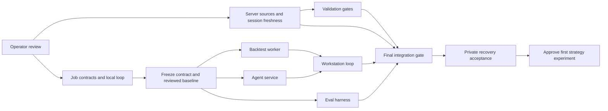

# Research Foundation Portfolio Implementation Plan

> **For agentic workers:** REQUIRED SUB-SKILL: Use superpowers:subagent-driven-development or superpowers:executing-plans to implement the approved subsystem plans task-by-task. Steps use checkbox syntax for tracking. The operator requested separate sessions after review; do not start sessions before that review.

**Goal:** Deliver a persistent research-job-to-report user loop with an independent advisory Agent service before adding strategy families.

**Architecture:** Freeze one shared contract, then implement isolated backtest and Agent workers in parallel. Integrate their outputs through the existing QuantMesh API/UI and validate recovery on owned test resources. Option B adds research-host redundancy; neither option claims whole-product HA.

**Tech Stack:** Existing Python/FastAPI/Pydantic/React/Vite research and AI adapters; SQLite local mode; separately locked PostgreSQL/LangGraph research service; immutable artifact storage and private networking.

**Spec:** `docs/superpowers/specs/2026-10-12-research-foundation.md`.

Status: APPROVED Option A2026-10-12. User authorizes separate sessions in bounded
batches. B is unselected. PR166 CI succeeded; PR remains OPEN. Current rollout
adds server-source independence and global calendar-aware freshness under#169.
Estimates start after approval, in working days, not continuous unattended hours.

## Global Constraints

- One active product iteration. Parallel sessions are bounded slices inside that iteration; soak stays disabled.
- Paper default, live execution disabled, AI advisory only, no credential/data leakage.
- New branches start at verified `origin/main`; preserve divergent local main. No admin/force merge.
- Reuse existing CostModel, WalkForwardSpec, reports and model gateway; no new trading engine.
- Exact-head required checks and applicable human/reviewer gates precede integration. Review at most two rounds per slice.
- Final clean-checkout certification remains mandatory; path-tier speedups cannot skip safety assertions.
- No new server, paid API call, session or helper replacement before its specified approval/gate.
- No arbitrary user Python or AI-generated program execution in foundation v1.

## Review Focus

1. Duplicate request/retry after ambiguous response must return one job; mismatched digest must return 409 (Foundation Task 2).
2. Worker lease loss or late cancellation must fence stale report publication (Workers Task 1).
3. Dataset replacement/future timestamps or insufficient export permission must fail before execution (Foundation Task 2, Workers Task 1).
4. Agent timeout, unknown pricing or credential-shaped output must not corrupt deterministic results or leak secrets (Workers Task 2).
5. Changed Eval cases or unknown changed paths must not inflate success or weaken final release coverage (Foundation Tasks 1 and 3).

## Priority and time envelope

| Phase | Working-day window | User-visible deliverable / exit | Effective engineer-days |
| --- | --- | --- | --- |
| 0 — Existing repair closeout | D1, overlapping planning baseline | PR #166 exact-head CI/reviews/merge record; installed state explicitly separate | 0.5–1 |
| 1 — Validation and job contracts | D1–D3 | #132 tier selector, versioned job/strategy contracts and local durable submission | 4–5 |
| 2 — Workers | D4–D8 | Existing baseline produces immutable report; independent Agent analysis survives restart | 7–9 |
| 3 — Workstation loop and evaluation | D9–D11 | Submit/status/reload/report UI; #160 frozen offline evidence comparison | 4–5 |
| 4 — Private integration and recovery | D12–D13 | Approved private service, budget limits, backup restore, failure isolation | 2–3 |
| Buffer / gates | D14–D16 | CI/review fixes, provider variance and operator acceptance | 2–4 |
| Option B only | Additional 4–6 days | Two research hosts, HA store and actual failover proof | 4–6 |

Original research foundation Option A: **12–16 working days**, approximately 3–4 weeks, **20–27 effective
engineer-days**. Option B: **16–22 working days**, approximately 4–5 weeks,
**24–33 effective engineer-days**. These are planning ranges, not an SLA; they
exclude waiting for account access, historical data licenses and unusually long
CI queues. A 4–5 day phase is split into independently reviewed 24–48 hour user
loops. Server migration/calendar unification adds a **2–4 working day allowance**;
combined A planning envelope is **14–20 working days**, with overlap where
independent and human authentication waits excluded. Multiple sessions share quota and coordination time; no linear speedup.

Approval on Oct 12 would put an Option A target around late October/early
November, and Option B in early/mid November. Day numbers are authoritative;
the calendar shifts if review/access starts later.

## Parallel session batches and ownership

The current root remains coordinator. User freshness steering moves#169 ahead
of#132 in the first batch; #132 follows the first source slice, never a third
concurrent writer. Open at most **two implementation sessions
at once**, plus a bounded reviewer/verifier when needed. Do not open every future
session on day one. Each session uses a managed worktree from the frozen baseline,
one deliverable, one stop condition and named forbidden actions.

| Batch | Session / deliverable | Exclusive writable scope | Dependency / stop condition |
| --- | --- | --- | --- |
| After first source slice | Validation #132 | `tools/validation_gates.py`, its tests, assigned CI workflow, validation docs | Independent of contracts; stop at green deterministic selector and full-tier fallback |
| A | Server/session freshness #169 | `src/quantmesh/live/session_freshness.py`, assigned live consumers/tests, server-source qualification plan | First global session-aware semantics slice; stop before vendor login/cutover |
| A | Job contracts / local loop | `src/quantmesh/research/jobs.py`, `strategy_registry.py`, `job_store.py`, new contract/store tests | Stop at reviewed v1 contract and durable local submit/status; root freezes it |
| B | Backtest Worker | `job_runner.py`, `job_artifacts.py`, worker tests | Requires frozen contract; stop at deterministic pinned-baseline report and fenced recovery |
| B | Independent Agent service | `services/research_agent/`, its service tests/lock/runbook | Requires same contract; stop at private persistent advisory run and bounded budgets |
| C | Workstation research jobs | New API router and `ResearchJobs.tsx` plus their tests | Requires both worker boundaries; stop at browser submit/reload/report loop |
| C | Eval #160 | `tools/workflow_eval.py`, `tests/workflow_eval/`, evaluation tests/docs | Case catalog can be prepared earlier read-only; stop at 24-case reproducible comparison |
| D | Coordinator + verifier | Integration, deployment/runbooks, evidence, iteration records | No new feature track; stop at approved profile acceptance and honest residual gates |

Shared files have one writer: root owns `src/quantmesh/api/workstation.py`,
frontend `App.tsx` and shared API client/schema, root dependency lock changes,
ADR/roadmap/ACTIVE/iteration updates and merge/deployment. A subsystem session
supplies a patch proposal for shared files; root integrates it sequentially.
Validation session owns its workflow until it lands; others never edit it.
Reviewers are read-only. Sessions do not merge each other or message outside
their authorized project coordination scope.

## Session launch and integration procedure

- [ ] Root verifies PR #166 state once per actionable checkpoint, not repeated stale CI runs. Merge only exact green head and applicable review gates; record actual installed digest separately.
- [ ] After operator approves this portfolio, root reconciles required docs/Git/issues and records a new active product iteration with one user action and explicit non-goals. Keep deferred soak status intact.
- [ ] Issues#167/#168/#169 created for portfolio/jobs/server sources; create remaining worker/service/UI issues at their batch boundaries; reuse #132/#160. Each issue links this spec and its subsystem task.
- [ ] List available projects, then create Batch A server-session-freshness#169 and job-contracts#168 chats using managed worktrees and the user's configured model; no invented model override or branch base.
- [ ] Include baseline SHA, issue, exact files, interface, acceptance commands, stop condition, forbidden live/source/disruptive actions in every launch prompt.
- [ ] Use compact thread waits/status snapshots. Do not redispatch completed work. A failing dependency stops its consumer while independent approved work continues.
- [ ] Root verifies evidence, performs Spec/Standards review within two rounds, integrates a green coherent checkpoint, then starts the next batch from that reviewed tree.
- [ ] Every slice preserves RED/GREEN evidence and completes its relevant broad boundary checks; one final exact-head clean-checkout release gate certifies the milestone. No concurrent all-suite processes on one Windows host.
- [ ] Use PRs under repository policy. A single final milestone PR is allowed only if ACTIVE explicitly records the solo fast lane; otherwise use bounded slice PRs. Required checks/reviews are never waived by this plan.
- [ ] Private deployment is a concrete final review step: exact image/package digests, resource bill, secret configuration instructions, rollback and recovery procedure prepared first; create paid resources only under the operator's explicit selected budget/server authorization.
- [ ] Mirror acceptance into ACTIVE/iteration/roadmap and record merged versus deployed versus operator-tested states independently. Leave long goal ACTIVE for deferred gates.

## Budget for approval

USD, list-price estimate checked Oct 12. Taxes, transfer overage, paid datasets,
GPU, human salary and current Codex subscription are excluded. No purchase has
been made. Existing-resource costs are not incremental development costs.

| Incremental monthly item | A — recoverable single research host | B — redundant research service |
| --- | ---: | ---: |
| New 8 GB Linux research hosts | 1 × $44 = $44 | 2 × $44 = $88 |
| PostgreSQL | Included on new host | Encrypted 2 GB managed HA: $60 |
| Off-host encrypted backups/artifacts estimate | $5–10 | $10 |
| Model API operating allowance | $50 | $100 |
| Incremental total | **$99–104/month** | **$258/month** |
| Proposed approval ceiling, including headroom | **$120/month** | **$300/month** |

Existing 8 GB staging list price is $44/month, so estimated combined totals are
$143–148 for A or $302 for B before retained rollback/tax. If the old 2 GB
rollback instance is still billed, add approximately $12/month; billing is not
verified and no resource is deleted implicitly. A's off-host estimate includes
job backups and small baseline artifacts, not a full large licensed data lake.
B's storage/network profile must be priced again before resource creation.

One-off incremental model/API development budget: **$200 maximum**, including
an optional RD-Agent/Qlib fixed bake-off of at most $25. This is an allowance,
not a forecast of tokens consumed or an extra Codex fee. No external developer
is hired by this plan; an outsourced quote would be the engineer-day range
multiplied by the operator's chosen daily rate.

Record each model's actual input/output prices before enabling paid calls.
Cost = aggregate input tokens × input unit price + output tokens × output unit
price + tool/provider fees. For illustration only, prices of $2/$10 per million
and 100 jobs each consuming 60k/12k total tokens would cost $24; this is not a
provider quote. Budgets reserve estimated spend and stop new calls when exhausted;
actual provider billing can differ. Do not start unlimited autonomous search.

Pricing source: [AWS Lightsail](https://aws.amazon.com/lightsail/pricing/).
The encrypted HA database option is deliberately not the cheaper unencrypted
1 GB tier. API provider/model is selected with the operator, not inferred from
the API key.

## Subsequent backlog and effort — not launched now

| Order | User value | Additional working days | Extra budget / data dependency |
| --- | --- | --- | --- |
| 1 | Qualified history import and reproducible dataset audit | 3–5 per first source | Existing permitted data first; vendor license/coverage can extend schedule |
| 2 | Trend baseline + screenshot staged-position overlay | 3–5 | Existing compute/API allowance; define thresholds and sizing before running |
| 3 | PIT liquidity/flow cross-sectional neutral portfolio | 5–8 | Universe/delist/borrow or funding history; no fee-free shorting assumptions |
| 4 | Statistical alpha templates / constrained factor experiments | 4–6 | Qualified multi-instrument history and out-of-sample evaluator |
| 5 | Macro and value templates | 4–8 each | PIT macro releases/fundamentals; no proprietary Soros/Buffett replication claim |
| 6 | User-configurable templates + validated factor DSL | 3–5 | Versioned schemas/limits; may be prioritized before additional strategy families |
| 7 | User Python plugins | 5–8 | Dedicated untrusted-code sandbox, capabilities and isolation admission |
| Separate | Polymarket real-data loop; then Kalshi authenticated loop | 2–4 / 3–5 | Venue access/credentials and mapping; one venue slice at a time |
| On demand | Windows real login/outage, capacity/shutdown/firewall/rollback drills | 1–3 active days plus chosen observation period | Operator windows; formal 168h remains not required |

These are alternatives ordered by value, not promises to develop all at once.
Do not sum them into an approved project or spend envelope. Strategy results
need chronological out-of-sample tests and paper evidence before promotion.
Private research availability is the foundation target; public SaaS and
real-money launch require a separately scoped authorization and estimate.

## Requirements and handoff

- [x] Operator selects A; operating ceiling $120/month and one-off development API allowance $200. Authentication/payment/key needs must be announced ahead.
- [ ] Foundation plan implements validation, contracts, stores and #160.
- [ ] Workers plan implements deterministic baseline jobs, Agent boundary, UI and recovery.
- [ ] Existing source/credential/live boundaries remain unchanged.
- [ ] Exact-head clean-checkout certification and private browser/recovery evidence pass.
- [ ] Strategy expansion is separately specified after foundation acceptance.

Subsystem execution plans:
[Contracts and evaluation](2026-10-12-research-contracts-eval.md),
[Workers and workstation](2026-10-12-research-workers-workstation.md).
Self-review: coverage mapped above; types and defaults match the spec; five
failure modes have named owning tests; budget totals reconcile; deployment
tiers distinguish recovery from redundancy. Dispatch is authorized; no new runtime implementation at approval checkpoint.
